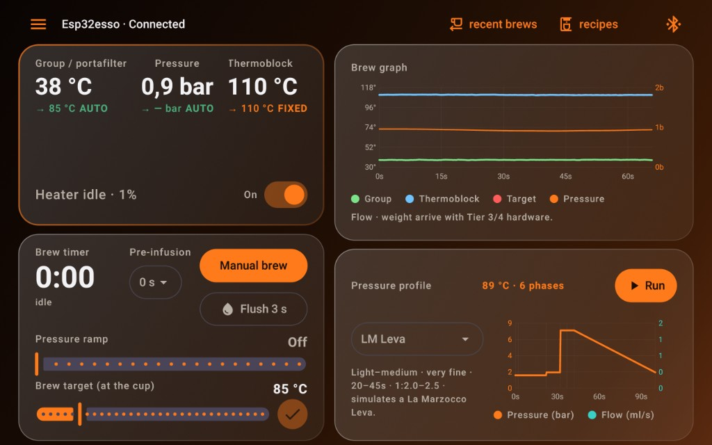

# Esp32esso Android app

Companion app for the ESP32 espresso controller. Connects over BLE to watch
live telemetry, tune the brew, time shots, and edit machine settings — no WiFi.

The GATT contract lives in [`../protocol/ble/tier2.md`](../protocol/ble/tier2.md).




## Requirements

- Android 8.0+ (API 26) phone or tablet with BLE
- An Esp32esso board flashed with a BLE env (`esp32-oster-xpert` or
  `esp32-s3-oster-xpert`)

## Build

Open `app-android/` in Android Studio (recommended) and run on a device, or
from a shell with the Android SDK installed:

```bash
cd app-android
./gradlew assembleDebug
```

Install the debug APK:

```bash
adb install app/build/outputs/apk/debug/app-debug.apk
```

## Usage

1. Power the machine (or the bare dev board) and confirm the firmware advertises
   as **Esp32esso**.
2. Grant Bluetooth permissions when prompted.
3. Tap **Connect** — the app scans for the service UUID and connects.
4. Read the **group** (portafilter), **pressure**, and **thermoblock** values.
   Tap any of the three to set it: the group reading sets the **brew target**
   (the cup temperature), the other two switch between tracking the loop and a
   fixed operator-held value.
5. Pick a **pressure profile** and hit **Run**, or start a **manual brew** with
   the pump ramp and brew target you set by hand. Either way the live **brew
   graph** plots the shot, and a marker tracks where the profile is.
6. Open **Settings** (gear icon) to edit the PID gains and steam target; changes
   persist on the ESP32.
7. **Recent brews** keeps the shot history: rate a shot, edit its report, or
   pull up the last one if you dismissed the dialog.

## Scope

- Three-way readout: group/portafilter, brew pressure, and thermoblock, each
  tappable to hold a fixed target or hand it back to the loop
- Bundled pressure/flow profiles (gaggimate, gaggiuino, Decent) with a
  characteristic graph and a playhead following the running shot
- Manual brew with a pump-ramp slider, pre-infusion, flush, and brew target
- Shot timer: manual start/stop plus auto from a wired brew switch
- Live brew graph (thermoblock / group / target / pressure), with flow and
  weight lanes reserved for Tier 4 hardware
- Brew history with ratings, editable reports, and a rankings view
- Machine settings: inner PID gains and steam target

Dark theme with an orange accent and frosted-glass surfaces. Profile editing,
scales, and OTA arrive in later stages.

